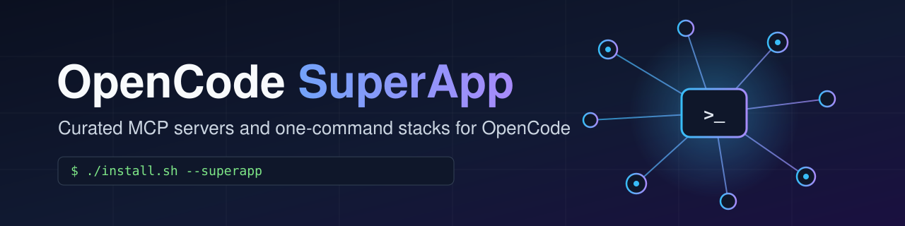
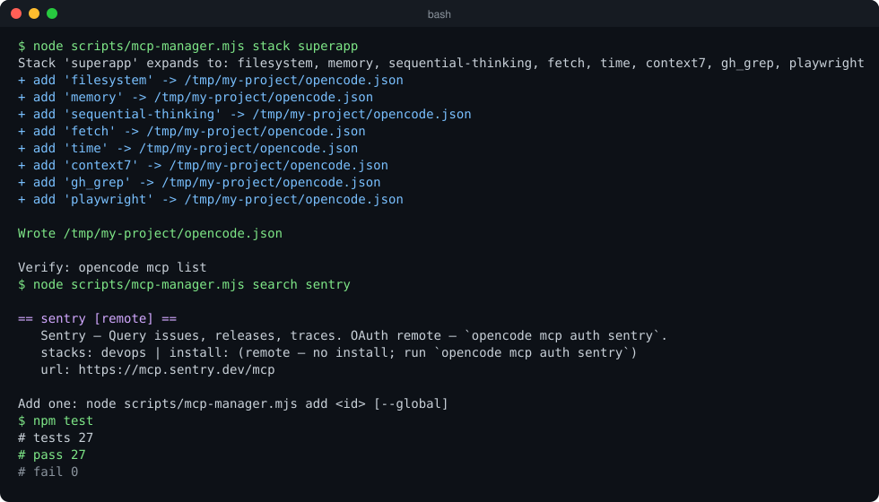
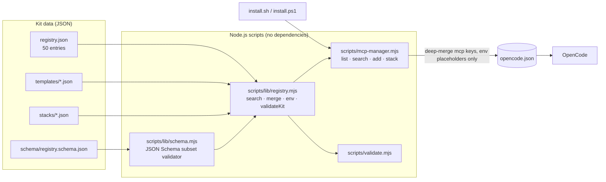

<p align="center">
  
</p>

<p align="center"><b>Curated MCP servers and one-command stacks for OpenCode</b></p>

<p align="center">
  <a href="LICENSE"></a>
  
  <a href="https://github.com/muhib-karim/opencode-superapp/actions/workflows/ci.yml"></a>
  <a href="registry.md"></a>
  <a href="docs/STACKS.md"></a>
  <a href="package.json">= 18"></a>
  <a href="https://ko-fi.com/ai_dev_2024"></a>
</p>

[OpenCode](https://opencode.ai) is an AI coding agent for the terminal that works
with any model, including the free models on
[OpenCode Zen](https://opencode.ai/auth) (see [docs/FREE-MODELS.md](docs/FREE-MODELS.md)).
Out of the box it has no *tools*: no repo access, memory, live docs, web search or browser.
Those come from [MCP (Model Context Protocol)](https://modelcontextprotocol.io) servers.

**OpenCode SuperApp** fills that gap. It is a curated, validated registry of
**50 MCP servers** (37 local, 13 remote), grouped into **7 ready-made stacks**, plus a
**zero-dependency Node.js CLI** that merges them into your `opencode.json` without
ever writing a secret to disk.

## Key features

- **Curated registry**: [`registry.json`](registry.json) describes each server (transport, command or URL,
  required env vars, category, stacks). A human-readable index is in [registry.md](registry.md).
- **Standard templates**: one `templates/<id>.json` per server, in the official
  [OpenCode MCP config format](https://opencode.ai/docs/mcp-servers/).
- **7 stacks**: `superapp`, `web-dev`, `data-analysis`, `devops`, `ai-search`, `productivity` and `testing`.
  The `superapp` stack is 8 servers with no required API keys. The tests check that.
- **Searchable CLI** (`scripts/mcp-manager.mjs`): `list`, `search`, `add` and `stack`. It
  deep-merges the `mcp` section and never deletes your other config keys.
- **Secret hygiene**: templates use only `{env:VAR}` placeholders. The installer prints
  `export` hints and never writes key values, and the validator rejects common literal-token
  patterns (`ghp_`, `xoxb-`, `AKIA`, `sk-live`).
- **Schema-validated**: `registry.json` is checked against a
  [JSON Schema](schema/registry.schema.json), and its entries are cross-checked against the
  templates and stacks. Counts are measured from the files, not hardcoded.
- **Cross-platform installers**: `install.sh` (macOS/Linux/WSL) and `install.ps1` (Windows),
  each with an interactive menu.

## Demo

A real terminal session, rendered to SVG from actual command output:

<p align="center"></p>

## Quick start

**1. Install OpenCode** (see the [OpenCode docs](https://opencode.ai) for other methods):

```bash
curl -fsSL https://opencode.ai/install | bash   # macOS / Linux
npm install -g opencode-ai                       # any OS with Node
```

**2. (Optional) connect free models:** sign in at [opencode.ai/auth](https://opencode.ai/auth),
then in the OpenCode TUI run `/connect` → OpenCode Zen, and `/models` to browse.
Details and the current model list: [docs/FREE-MODELS.md](docs/FREE-MODELS.md).

**3. Install the kit.** It needs only Node.js 18 or later; there are no npm dependencies:

```bash
git clone https://github.com/muhib-karim/opencode-superapp.git
cd opencode-superapp

./install.sh --superapp        # macOS / Linux / WSL  (or ./install.sh for the menu)
# .\install.ps1 -Superapp      # Windows PowerShell   (or .\install.ps1 for the menu)
```

This merges 8 servers into `./opencode.json` (or pass `--config <path>` / `--global`):

| Tool | Your agent can now… |
|---|---|
| `filesystem` | read/write/search your project |
| `memory` | keep a knowledge graph across sessions |
| `sequential-thinking` | reason step by step on hard problems |
| `fetch` | turn any URL into markdown |
| `time` | get correct dates and timezones |
| `context7` | pull current docs for a library |
| `gh_grep` | search public GitHub code for real examples (grep.app) |
| `playwright` | drive a real browser: click, fill, screenshot |

Verify inside OpenCode with `opencode mcp list`.

## Usage

```bash
node scripts/mcp-manager.mjs --help                     # usage
node scripts/mcp-manager.mjs list                       # all 50 servers
node scripts/mcp-manager.mjs list --stack devops        # servers in a stack
node scripts/mcp-manager.mjs list --type remote --json  # machine-readable
node scripts/mcp-manager.mjs search postgres            # search id/title/description/category
node scripts/mcp-manager.mjs stack web-dev              # merge a whole stack into ./opencode.json
node scripts/mcp-manager.mjs add github sentry --global # ~/.config/opencode/opencode.json
node scripts/mcp-manager.mjs add github --config ./my.json
```

npm script shortcuts: `npm run superapp`, `npm run list`, `npm run search -- <q>`, `npm run stack -- <name>`.

| Stack | Servers | What it adds |
|---|---|---|
| ⭐ `superapp` | 8 | the keyless essentials above |
| `web-dev` | 14 | git, github, browsers, figma, vercel, netlify, shadcn, supabase, docs |
| `data-analysis` | 10 | postgres, sqlite, mysql, mongodb, redis, supabase, prisma, neon, memory |
| `devops` | 12 | docker, kubernetes, terraform, aws-docs, azure, cloudflare, digitalocean, grafana, datadog, sentry |
| `ai-search` | 10 | brave, tavily, exa, firecrawl, fetch, context7, gh_grep, youtube-transcript |
| `productivity` | 9 | slack, discord, linear, notion, jira, confluence, google-drive, obsidian |
| `testing` | 7 | playwright, puppeteer, chrome-devtools, firecrawl, everything (reference server) |

Stacks merge, so you can run the command twice to combine them. Full details are in [docs/STACKS.md](docs/STACKS.md).

When a server needs credentials, the installer prints what to set in your shell. Values are never written to JSON:

```bash
export GITHUB_PERSONAL_ACCESS_TOKEN="..."      # bash/zsh
$env:GITHUB_PERSONAL_ACCESS_TOKEN="..."        # PowerShell
opencode mcp auth sentry                       # OAuth remote servers
opencode mcp debug <name>                      # when something fails
```

### Five rules that prevent most failures

1. Keep secrets in the shell (`{env:VAR}`), never in JSON. See [docs/TROUBLESHOOTING.md](docs/TROUBLESHOOTING.md).
2. Use `environment` for **local** servers and `headers` for **remote** servers. Swapping them is the most common cause of a 401.
3. Key-based remotes need `"oauth": false`. OAuth remotes need `"oauth": {}` plus `opencode mcp auth <name>`.
4. Keep to about 8 servers per session, and turn heavy ones on per agent (see `opencode.example.json`).
5. Run `npm run validate` after every hand-edit.

## Architecture



- **Data**: `registry.json` is the catalog. `templates/` contains the exact config snippets
  that get installed. `stacks/` holds named sets of server ids, and these files decide what
  `stack` installs and what `list --stack` shows.
- **Library**: pure helpers in `scripts/lib/` are shared by the CLI and the validator, which keeps them easy to unit test.
- **Installers**: thin shell and PowerShell wrappers around the CLI.

## Testing

```bash
npm run validate   # schema check of registry.json + template/stack consistency + secret scan
npm test           # 27 tests: schema validator, registry helpers, and CLI smoke tests (node:test)
```

The tests use Node's built-in `node:test` runner and need no install step. They cover:
- the shipped `registry.json` against the JSON Schema,
- negative cases on temporary copies of the kit (duplicate id, missing or orphan template,
  literal secret, type mismatch, unknown stack member),
- config merging that never drops existing keys,
- the real CLI run as a child process (`--help`, `list`, `search`, `stack`, `add`, and error exit codes).

CI ([`.github/workflows/ci.yml`](.github/workflows/ci.yml)) runs the validator, the tests and an
installer smoke test on every push and pull request.

## Project structure

```
.
├── registry.json            # catalog of 50 MCP servers
├── registry.md              # human-readable index
├── schema/                  # JSON Schema for registry.json
├── templates/               # one opencode.json snippet per server (50)
├── stacks/                  # 7 named server bundles
├── scripts/
│   ├── mcp-manager.mjs      # CLI: list / search / add / stack
│   ├── validate.mjs         # schema + consistency validator
│   └── lib/                 # shared pure helpers (registry.mjs, schema.mjs)
├── test/                    # node:test suites
├── install.sh / install.ps1 # one-click installers
├── opencode.example.json    # per-agent tool gating example
└── docs/                    # STACKS, FREE-MODELS, TROUBLESHOOTING, banner, demo
```

## Limitations and roadmap

- The kit installs *configuration*. Whether a server actually starts depends on its own
  runtime (`npx`, `uvx` or Docker) and credentials. Run `opencode mcp list` / `opencode mcp debug <name>` to check.
- The tests check the structure and safety of the registry, not that every third-party
  server package or URL is still live.
- `registry.md` is maintained by hand alongside `registry.json`.
- `install.ps1` is not covered by CI (Linux runner only).
- The free-model list in [docs/FREE-MODELS.md](docs/FREE-MODELS.md) may change on OpenCode's side.

## Contributing

You can add a server in about 10 minutes. The checklist is in [CONTRIBUTING.md](CONTRIBUTING.md).
Please redact all secrets in bug reports. Security issues: [SECURITY.md](SECURITY.md).

## Support

If this kit helped you, you can [buy me a coffee on Ko-fi](https://ko-fi.com/ai_dev_2024).

## License

[MIT](LICENSE). Not affiliated with OpenCode/Anomaly. The config format follows the
[official MCP docs](https://opencode.ai/docs/mcp-servers/).
